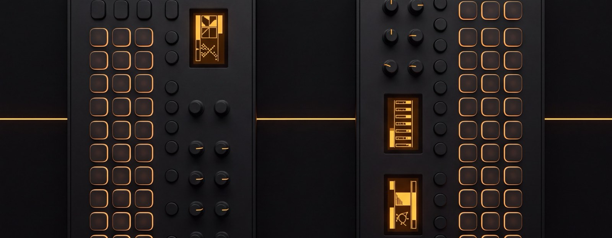

<p align="center">
  
</p>

# Digitakt + Digitone MCP

MCP servers that let an LLM play your Elektron hardware over MIDI — trigger tracks, tweak
parameters, run clock-synced patterns, and export what it made to `.mid`.

<p>
  <a href="https://jamiew.github.io/digitakt-digitone-mcp/"><strong>jamiew.github.io/digitakt-digitone-mcp</strong></a>
</p>

Two servers ship today, and **you install and run them independently**:

| Server | Device | Tools | ~Token cost |
|--------|--------|-------|-------------|
| `digitakt-mcp` | Elektron Digitakt (original) | 44 | ~5.2k |
| `digitone-mcp` | Elektron Digitone (original) | 43 | ~5.1k |

They share one implementation internally — a device is a `DeviceSpec` (port name, track
count, parameter table) over a common core — but each is its own MCP server with its own
storage and its own tool list. Installing only the Digitakt costs you nothing for the Digitone.

> **Which hardware?** This targets the **original** Digitakt and Digitone, not the
> **Digitakt II** or **Digitone II**. The mk2 machines have different track counts, more
> LFOs, and different parameter maps — see [Other Elektron devices](#other-elektron-devices).

---

## Install

Requires Python 3.11+ and [uv](https://docs.astral.sh/uv/).

```bash
curl -LsSf https://astral.sh/uv/install.sh | sh   # if you don't have uv

git clone https://github.com/jamiew/digitakt-digitone-mcp
cd digitakt-digitone-mcp
uv sync
```

Connect the device over USB first. Ports are matched by name, so there's nothing to
configure as long as it appears as "Elektron Digitakt" / "Elektron Digitone" — on macOS
you can confirm in Audio MIDI Setup. If you use Overbridge, the Overbridge Engine needs
to be running.

Working inside this repo? Claude Code reads the checked-in `.mcp.json` and offers both
servers when you open it. Turn off the one you aren't using in `/mcp`; each costs about
6k tokens of tool schema.

---

## Digitakt

Original Digitakt: 8 audio tracks, 8 separate MIDI tracks, one LFO per track, no chorus.

### Setup

```bash
uv run digitakt-mcp
```

Claude Code:

```bash
claude mcp add digitakt -- uv --directory /path/to/digitakt-digitone-mcp run digitakt-mcp
```

Claude Desktop (`~/Library/Application Support/Claude/claude_desktop_config.json`) or any
other MCP client:

```json
{
  "mcpServers": {
    "digitakt": {
      "command": "uv",
      "args": ["--directory", "/path/to/digitakt-digitone-mcp", "run", "digitakt-mcp"]
    }
  }
}
```

### On the device

**Per-track MIDI channels.** The server addresses tracks on their own channels, so track
triggers and per-track parameter changes need this. Without it only the currently selected
track responds, and parameter changes silently hit the wrong track.

1. Press **[FUNC] + [SETTINGS]**
2. **MIDI → CONFIG → CHANNELS**
3. Set each track's MIDI IN channel to match its number (TRK 1 → ch 1 … TRK 8 → ch 8)

The alternative is leaving everything on Auto Channel, which is simpler but means you
cannot trigger multiple tracks at once.

**Transport and clock**, needed for every `play_*` tool:

1. Press **[FUNC] + [SETTINGS]**
2. **MIDI → SYNC**
3. **CLOCK RECEIVE** → ON, **TRANSPORT RECEIVE** → ON

**NRPN output**, under **MIDI → CONFIG → PORT CONFIG**, if you want the device's own knob
moves to come back as NRPN — several parameters have no CC at all and are NRPN-only.

### Quirks

- **Notes 0–7 trigger tracks 1–8.** Notes 12–84 play the *active* track chromatically.
  `trigger_track` wraps this so you don't have to do the arithmetic.
- **Volume is CC 7 and Pan is CC 10**, and Delay/Reverb sends live in the AMP page. The
  Digitakt II moved these; parameter maps from mk2 sources will not work here.
- **One LFO.** Anything referencing `lfo2`/`lfo3` is a Digitakt II parameter.
- **Trig editing is NRPN-only** (`set_trig_note`, `set_trig_velocity`, `set_trig_length`).
  MSB 3/4/5 select note/velocity/length; the LSB is the zero-based step index.

### Tips

- `play_pattern_with_tracks` sends real MIDI clock, so the Digitakt's own sequencer stays
  locked to whatever the model is playing.
- `play_pattern_with_multi_channel_midi` is the one to reach for when driving Digitakt
  drums *and* a synth on MIDI tracks 9–16 in the same pattern.
- Ask for `list_parameters` before setting up automation — names are specific
  (`filter_cutoff`, not `cutoff`).

---

## Digitone

Original Digitone: 4 FM synth tracks, 8 voices shared across them, 2 LFOs per track,
and a chorus the Digitakt doesn't have.

### Setup

```bash
uv run digitone-mcp
```

Claude Code:

```bash
claude mcp add digitone -- uv --directory /path/to/digitakt-digitone-mcp run digitone-mcp
```

Or in an MCP client config:

```json
{
  "mcpServers": {
    "digitone": {
      "command": "uv",
      "args": ["--directory", "/path/to/digitakt-digitone-mcp", "run", "digitone-mcp"]
    }
  }
}
```

### On the device

Same idea as the Digitakt — **[FUNC] + [SETTINGS] → MIDI → CONFIG → CHANNELS**, with
tracks 1–4 on channels 1–4, and **MIDI → SYNC** with CLOCK RECEIVE and TRANSPORT RECEIVE
on. NRPN output matters more here: the Digitone has more NRPN-only parameters than the
Digitakt.

The chorus is a send effect and answers on the **FX channel, default 9** — `set_chorus`
targets that channel, not a track.

### Quirks

- **Everything is chromatic.** There are no trigger notes; every track plays pitched.
- **Tracks are polyphonic** — use `play_chord` rather than stacking `send_note` calls.
  All four tracks share one 8-voice pool, so a 4-note chord on two tracks is your budget.
- **Algorithms are 1–8 on screen but 0–7 over MIDI.** `set_algorithm` takes the number you
  see on the device and converts.
- **`filter_cutoff` is CC 23 here, not CC 74** like the Digitakt. Parameter names are
  shared across devices but the CC behind them is not — always go through `set_parameter`
  rather than hardcoding CC numbers.
- **Operator B is a pair.** `ratio_b` and `b_level` move B1 and B2 together; the Digitone
  exposes no separate control for them over MIDI.

### Tips

- FM starting points: integer ratios (1, 2, 3) are harmonic and saw/square-ish;
  non-integer ratios give bells and metal. Raise `set_operator_levels` for brightness.
- `set_operator_envelope` has an `end` level, which is FM-specific — it's the modulation
  depth *held* after decay, and it's what makes a patch evolve rather than just decay.
- Algorithm 8 is all carriers (organ/additive); algorithm 1 is a full cascade and the most
  aggressive. `set_algorithm` returns the routing diagram in its response.

---

## What both servers can do

| Category | Tools |
|----------|-------|
| Core MIDI | `send_note`, `send_cc`, `send_nrpn`, `send_program_change`, `send_sysex`, `send_note_sequence` |
| Transport | `send_midi_start`, `send_midi_stop`, `send_midi_continue`, `send_song_position` |
| Parameters | `list_parameters`, `set_parameter` |
| Playback | `play_with_clock`, `play_pattern_with_melody`, `play_pattern_with_loop`, `play_pattern_with_multi_channel_midi`, `play_pattern_with_parameter_automation` |
| Automation | `send_parameter_sweep`, `send_parameter_envelope` |
| Patterns | `save_pattern`, `load_pattern`, `list_patterns`, `delete_pattern`, `update_pattern`, `edit_pattern_triggers`, `edit_pattern_chords` |
| Presets | `save_automation_preset`, `load_automation_preset`, `list_automation_presets` |
| Export | `export_pattern_to_midi`, `export_automation_to_midi`, `save_last_melody`, `save_last_pattern` |
| Recording | `monitor_midi_input`, `record_midi_input`, `list_midi_recordings`, `play_midi_file` |

Digitakt adds `trigger_track`, `set_trig_note`, `set_trig_velocity`, `set_trig_length`,
`reset_velocities`, `play_pattern_with_tracks`, `play_pattern_with_tracks_and_melody`, and
the storage tools below: `list_drive`, `list_sample_slots`, `load_sample`,
`upload_samples`, `bootstrap_kit`.

Digitone adds `play_chord`, `set_algorithm`, `set_ratios`, `set_operator_levels`,
`set_operator_envelope`, `set_chorus`. Both have `list_sounds`.

Each server also exposes three resources: `midi://ports`, `midi://<device>/status`, and
`midi://<device>/parameters` (the full parameter table as JSON, so the model can look up
names on demand instead of carrying them in every tool description).

Every tool carries MCP annotations, so clients can tell a note from a change that
overwrites a sound. Playback tools report progress once per bar, and cancelling one sends
MIDI Stop so the device doesn't hang mid-pattern.

### Where data goes

```
~/.mcp-config/digitakt/{patterns,presets,recordings}/
~/.mcp-config/digitone/{patterns,presets,recordings}/
```

---

## Other Elektron devices

This repo covers the machines the author owns. For everything else:

- **Digitakt II** — [`feamster/digitakt-midi-mcp`](https://github.com/feamster/digitakt-midi-mcp),
  the project this one grew out of. Its parameter map is built for the II.
- **Digitakt II / Digitone II** — [`roomi-fields/osc-bridge`](https://github.com/roomi-fields/osc-bridge)
  ships an MCP server with `digitakt_ii.json` (262 params) and `digitone_ii.json` (322),
  alongside Syntakt, Octatrack, Analog Four/Rytm and Tonverk.
- **Digitone II specifically** — [`zerubeus/elektron-mcp`](https://pypi.org/project/elektron-mcp/)
  on PyPI (`uvx elektron-mcp`) carries display-value↔MIDI scaling tables for the FM Tone,
  Wavetone and Swarmer engines. Its GitHub source has been deleted; the PyPI package and
  the [`ftupas/elektron-mcp`](https://github.com/ftupas/elektron-mcp) fork remain.
- **Any Elektron device, parameter data only** —
  [`pencilresearch/midi`](https://github.com/pencilresearch/midi) has CC/NRPN CSVs for
  essentially the whole Elektron line.
- **Sample and project transfer** (not MCP) —
  [`dagargo/elektroid`](https://github.com/dagargo/elektroid).

**Adding a device here** means writing one `DeviceSpec` in `src/elektron_mcp/devices/` —
port name, track count, parameter table, and any tools unique to the machine — not forking
the server. PRs welcome; a Digitakt II is mostly a new parameter map.

---

## Origins

This project began as a fork of
[`feamster/digitakt-midi-mcp`](https://github.com/feamster/digitakt-midi-mcp) by
[@feamster](https://github.com/feamster) — thank you. That repo is where the Digitakt
parameter tables and the first working set of MIDI tools came from, and having something
that already talked to the hardware is what made everything here possible. If you have a
Digitakt II, go there first: it targets that machine, and this one doesn't.

It's now a standalone repo rather than a fork, because the two have diverged to the point
where nothing meaningful could be merged in either direction.

**The difference that matters most is the hardware.** That project targets the
**Digitakt II**; this one targets the **original Digitakt** (and the original Digitone).
They are genuinely different machines over MIDI — its CC map puts AMP Volume on **CC 89**
and Pan on **CC 90**, where the mk1 uses **CC 7** and **CC 10**, and it assumes amp
sustain/release stages and a chorus send the mk1 doesn't have. Point the wrong map at your
hardware and parameters land in the wrong place, silently.

Everything else that changed:

| | `feamster/digitakt-midi-mcp` | this project |
|---|---|---|
| Target hardware | Digitakt II | Digitakt + Digitone, both originals |
| Devices | 1 | 2, each its own server, each installable alone |
| Structure | one 4,300-line `server.py` | `src/elektron_mcp/` package, devices as data |
| MCP API | low-level `mcp.server.Server` | `MCPServer` (mcp 2.x): resources, tool annotations, progress |
| Install | `requirements.txt` | `uv` + hatchling, console scripts, wheel |
| Python | 3.10+ | 3.11–3.14, `py.typed`, checked with `ty` |
| Tests | hardware scripts only | 95 tests with no hardware, plus a live LLM harness |
| CI | — | GitHub Actions: format, lint, types, tests, build |
| License | none | MIT |

The Digitone support, the shared device-spec core, the packaging, the tests and the type
checking are all new here. The CC/NRPN tables are the part with a shared ancestor, and
they've since been corrected for the mk1.

---

## Testing it

Go from cheapest to most real. Each step needs a bit more than the one before.

| Step | Command | Needs |
|---|---|---|
| Unit tests | `uv run pytest` | nothing |
| Poke single tools | `uv run python -m harness digitakt call trigger_track track=1` | the device on USB, or `--dry-run` |
| Scenario suite, no hardware | `uv run python -m harness digitone --dry-run test` | an API key |
| Scenario suite on the device | `uv run python -m harness digitakt test` | key + device |
| Free-form chat | `uv run python -m harness digitakt` | key + device |
| The real client | open the repo in Claude Code; `.mcp.json` offers both servers | Claude Code |

### The live harness

`harness/` drives either server with a real model, so you can check the MCP surface
without opening Claude or ChatGPT. It starts the server from `.mcp.json`, the same way
Claude Code does. Run it from the repo root.

Put one of these in your environment or in a `.env` file at the repo root (it's
gitignored): `ANTHROPIC_API_KEY`, `OPENAI_API_KEY` or `OPENROUTER_API_KEY`. The harness
uses the first one it finds. `--provider anthropic|openai|openrouter` picks one
explicitly, and `--model` overrides the default model.

```bash
uv run python -m harness digitakt                  # chat; /reset starts over, Ctrl-D quits
uv run python -m harness digitakt test             # scenario suite; exits 1 on any failure
uv run python -m harness digitakt test -k filter   # just the scenarios named *filter*
uv run python -m harness digitone --dry-run        # chat with no hardware; MIDI is captured
uv run python -m harness digitakt call             # list tools and resources, no key needed
uv run python -m harness digitakt call play_pattern_with_tracks \
    triggers='[[0,1,110],[1,2,100],[2,1,110],[3,2,100]]' bars=2 bpm=90
```

Every tool call prints as it happens (`→ set_parameter(name="filter_cutoff", ...)`),
followed by its result, with progress per bar for playback. The server's own log shows
each MIDI message it sends. Ctrl-C during playback sends MIDI Stop.

Each scenario in `harness/scenarios.py` is a prompt plus the tool calls that would answer
it. For example, "Set the filter cutoff on track 2 to 40" passes on
`set_parameter(name="filter_cutoff", value=40, channel=2)` or on the matching raw
`send_cc`. To add one, copy a scenario and list the calls that would count as success.

### Prompts to try

These work in the harness chat and in Claude Code. Tracks follow the device's default
channels (Digitakt tracks 1-8 on channels 1-8, Digitone tracks 1-4 on channels 1-4).

Digitakt:

- "Play 2 bars of boom bap at 90 BPM: kick on track 1, snare on track 2 on beats 2 and 4, track 6 on eighth notes."
- "Sweep the filter cutoff on track 6 from 20 up to 110 over 4 seconds."
- "On the sequencer, set steps 1, 5, 9 and 13 of track 1 to velocity 127 and the other steps to 80."
- "Save that beat as boom-bap-90, then export it to a MIDI file."
- "Which LFO parameters can you set? Then make the LFO on track 3 slow and deep."

Digitone:

- "Play Cmaj7 then Am9 on track 1, two bars each at 80 BPM."
- "Make track 2 a darker bass: algorithm 1, lower the A level, shorter decay."
- "Play one bar of bass on track 2 at 120 BPM: C2 on every eighth note, G1 on the last two."
- "Turn the chorus mix up to 90 and the depth to 60."
- "Give track 3 a bell sound with a non-integer A ratio, then play a C major arpeggio on it."

## Samples and the +Drive

MIDI can't see storage, so these tools use
[Elektroid](https://github.com/dagargo/elektroid)'s `elektroid-cli` over the same USB
cable. Install it first; without it, the storage tools say so and everything else still
works.

| Tool | What it does |
|---|---|
| `list_drive` | A +Drive folder, plus storage usage |
| `list_sample_slots` | Which slot each track plays, then the project's 127 slots (filter with `query`) |
| `load_sample` | Put a slot number, a +Drive path or a local WAV on a track |
| `upload_samples` | Copy a WAV or a folder of them onto the +Drive, keeping subfolders |
| `bootstrap_kit` | Pick a kick, snare, break, hats and crash from the project's slots at random (`dry_run` to preview) |
| `list_sounds` | A sound bank's names (both devices) |

There are also prompts: `new_kit` and `load_cipher_pack` on the Digitakt, and
`new_sounds` (texture, keys, bass, lead) on the Digitone. A `midi://digitakt/kit` resource
returns the tracks and slots as JSON.

Things to know:

- Switching to a sample that's already in the project is instant and uploads nothing.
  Anything else goes into a free slot, and elektroid keeps a copy in `/incoming` on the
  +Drive.
- Track sample changes go out as MIDI CC on each track's channel. If a track's channel is
  also the AUTO channel, the change lands on the active track instead. The tools read the
  tracks back and warn you when that happens.
- Nothing deletes from the +Drive. Save the project on the device to keep a new kit.

Prompts to try: "Suggest a new kit from my samples, but don't change anything yet", "Put
the Jungle Beat break on track 3", "Upload ~/dev/cipher/exports/atoll to /cipher and put
the drum loop on track 3".

`.claude/skills/elektron-bridge/SKILL.md` covers the rest with raw `elektroid-cli`
commands, and Claude Code picks it up automatically.

---

## Development

```bash
uv sync
uv run pytest              # 95 tests, no hardware needed
uv run ruff check .
uv run ruff format .
uv run ty check
```

Tests drive the real MCP surface (an in-process `mcp.client.Client`) against a recording
MIDI port, so tool registration, schema validation and error text are covered along with
the emitted bytes.

```
src/elektron_mcp/
  device.py      DeviceSpec + typed Parameter table
  midi.py        connection, message sending, logging
  clock.py       the one clock loop every playback tool shares
  storage.py     patterns / presets / recordings on disk
  midifile.py    .mid writing
  server.py      build_server(spec) -> a full MCPServer
  devices/
    digitakt.py  spec + trigger/trig tools
    digitone.py  spec + FM tools
harness/         live LLM harness: providers, scenarios, CLI
```

`scripts/hardware/` holds manual scripts that need a real device attached; they are not
part of the test suite.

---

## Credits and references

Built on:

- [mido](https://github.com/mido/mido) and
  [python-rtmidi](https://github.com/SpotlightKid/python-rtmidi) — MIDI I/O
- [Model Context Protocol](https://modelcontextprotocol.io/) and the
  [Python SDK](https://github.com/modelcontextprotocol/python-sdk)'s `MCPServer`

Device and protocol documentation:

- [Digitakt User Manual (OS 1.51)](https://www.elektron.se/wp-content/uploads/2024/09/Digitakt_User_Manual_ENG_OS1.51_231108.pdf)
  — the CC/NRPN appendix is the source for `digitakt_cc.py`
- [Digitone User Manual](https://www.elektron.se/support) — FM operator layout, algorithm
  routing, and the CC/NRPN appendix behind `digitone_cc.py`
- [midi.guide Elektron reference](https://midi.guide/d/elektron/) — cross-checking CC numbers
- [Elektronauts](https://www.elektronauts.com/) — community threads on NRPN behaviour and
  Elektron SysEx framing

Prior art and inspiration:

- [`feamster/digitakt-midi-mcp`](https://github.com/feamster/digitakt-midi-mcp) — the
  Digitakt MCP this project started from; see [Origins](#origins)
- [`pencilresearch/midi`](https://github.com/pencilresearch/midi) (CC-BY-SA-4.0) — CC/NRPN
  database covering the Elektron line, useful for cross-checking parameter maps
- [`roomi-fields/osc-bridge`](https://github.com/roomi-fields/osc-bridge) (GPL-3.0) —
  declarative one-file-per-device model, and a reason this repo treats devices as data
- [`TheAndrewStaker/mcp-midi-control`](https://github.com/TheAndrewStaker/mcp-midi-control)
  (Apache-2.0) — the "descriptors, not new tools" idea for keeping token cost flat
- [`zerubeus/elektron-mcp`](https://github.com/ftupas/elektron-mcp) (MIT) — closest prior
  art for Digitone parameter coverage
- [`mzero/elk-herd`](https://github.com/mzero/elk-herd) (BSD-2-Clause) — reference for
  Elektron SysEx pattern/project dump layout
- [`dagargo/elektroid`](https://github.com/dagargo/elektroid) (GPL-3.0) — Elektron device
  IDs and SysEx transfer protocol

No code was copied from the GPL/AGPL projects listed above; they were read as references only.

## License

MIT
