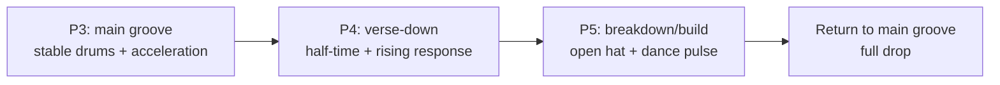
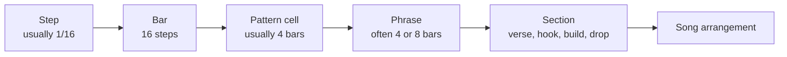
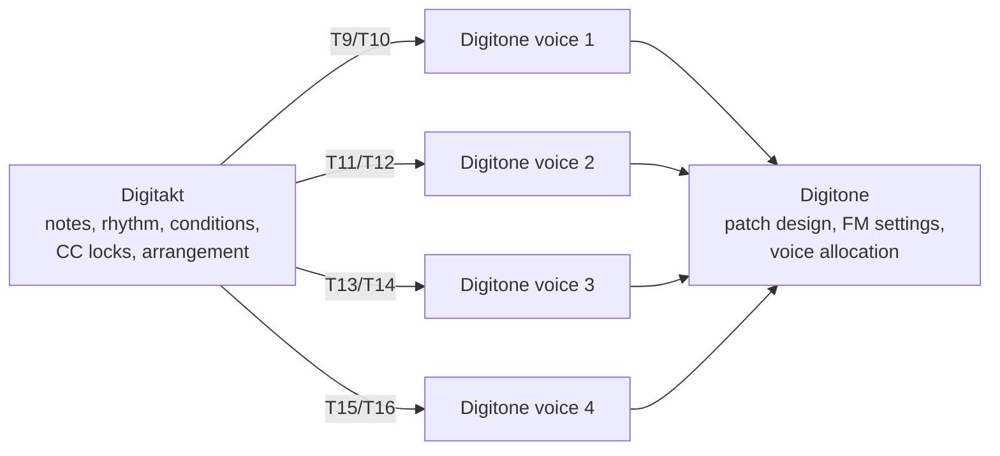
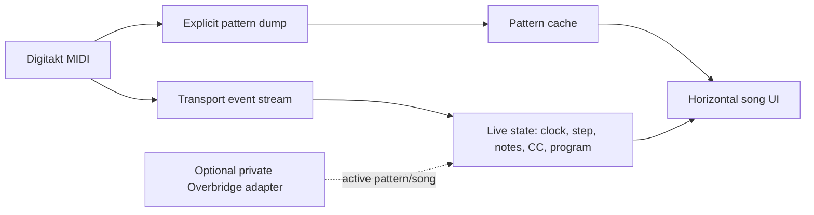

# Untitled Digitakt song: arrangement and sequencing notes

Jamie + OMP, November 3, 2026

The song name is unknown for now. This is the working analysis of the Digitakt project we inspected, the patterns we edited, the composition ideas behind those edits, and a proposed clean rebuild from P1 onward.

[Open the interactive song visualizer](docs/song-visualizer.html) for the horizontal arrangement, pattern grids, synthetic playback, Song Mode plan, and sequencing-trick diagrams.

## The short version

The raw song had good material, real groove detail, and useful conditional ideas. The main problem was hierarchy: drums, chopped percussion, bass, chords, and several Digitone voices often spoke at the same time. P1 was intended as a simplified edit, but it contained 119 programmed trigs versus P2's 112 because material moved onto additional MIDI tracks instead of truly leaving space.

I'd vote for three rules going forward:

1. Treat a Digitakt pattern as a reusable four-bar cell, not automatically as a whole section.
2. Build eight-bar phrases from two passes of a cell, then build 16-bar sections from two related phrases.
3. Use conditions for local variations and separate patterns for arrangement changes.

The practical reset is to archive the raw everything-on version in P16, rebuild the song from P1, and let Song Mode decide how long each pattern runs.

## 1. What was in the song

### Track roles

The original P2 pattern used these main roles:

| Track | Role | What it was doing |
|---|---|---|
| T1 | Kick | Mostly beats 1 and 3, plus a conditional retrig event |
| T2 | Snare | Backbeat plus a conditional end roll |
| T3 | Closed hat | Offbeat eighth notes with microtiming and conditions |
| T4 | Chopped break | 20 bright percussion hits layered over T3 |
| T9/T10 | Digitone voice 1 | Two dense parts addressing the same destination voice |
| T11/T12 | Digitone voice 2 | Bass and alternate bass part |
| T13/T14 | Digitone voice 3 | Lead and alternate lead part |
| T15/T16 | Digitone voice 4 | Turnaround or supporting voice |

The project was not rhythmically naive. It already used:

- velocity changes;
- early and late microtiming;
- conditional trigs;
- retrig rates and velocity curves;
- half-speed tracks;
- paired MIDI tracks for alternate Digitone parts.

The issue was not a lack of detail. It was too many detailed parts competing for the same moment.

### Density

These counts are programmed trigs, not the extra audible hits generated by retrigs:

| Pattern | Programmed trigs | Relative density | Meaning |
|---|---:|---:|---|
| P1 rough edit | 119 | 106% of P2 | Intended simplification, but added alternate MIDI-track activity |
| P2 original | 112 | 100% | Dense source arrangement |
| P3 edited groove | 60 | 54% | Main phrase and transition roll |
| P4 verse-down | 38 | 34% | Sparse half-time response |
| P5 breakdown/build | 36 | 32% | Two-bar break into dance pulse |

P1 demonstrates an important arranging lesson: redistributing notes is not the same as subtracting notes. Space only appears when a part actually stops.

### Why it felt samey and crowded

The parts were individually musical, but several had complete four-bar statements. That created five problems:

1. **No clear foreground.** Bass, lead, harmony, and percussion all asked for attention.
2. **Weak call and response.** Parts overlapped instead of handing the phrase to one another.
3. **High-frequency competition.** T3's closed hat and T4's bright chopped break occupied similar space.
4. **Repeated density.** Adding layers changed timbre but not the amount of musical information.
5. **Ambiguous transitions.** Fills happened on top of the full arrangement instead of replacing it.

A useful role hierarchy is:

```text
FOUNDATION     kick + snare + bass
HARMONY        chords, sample-like phrase, or pad
LEAD           rapper, lead synth, hook, scratch, horn
RESPONSE       counterline or fill in the lead's gaps
TEXTURE        noise, atmosphere, swell, tail
```

At any moment, one role should be the main speaker. The other roles should hold, simplify, or rest.

## 2. What changed in P3, P4, and P5

The edits were read back from the Digitakt after writing. Whether they survived disconnection depends on whether the project was saved on the device.

### P3: main groove and repaired acceleration

P3 keeps the recognizable song but removes competing layers.

| Track | Change |
|---|---|
| T1 | Replaced the rough syncopated kick with a mostly straight beats-1-and-3 pulse and one quiet `4&` pickup |
| T2 | Rebuilt the final bar as adjacent 1/8, 1/16, and 1/32 retrig regions |
| T3 | Kept one closed-hat voice, removed conditions, and lowered/reshaped velocities |
| T4 | Muted the chopped break completely |
| T9 | Kept the key response in even bars |
| T10 | Muted so it did not double the same Digitone voice |
| T11 | Kept bass movement in odd bars and simpler roots in even bars |
| T12/T14 | Muted alternate parts |
| T13 | Kept the existing half-speed lead phrase |
| T15 | Reduced to the final turnaround |

```text
P3    1e&a2e&a3e&a4e&a | 1e&a2e&a3e&a4e&a | 1e&a2e&a3e&a4e&a | 1e&a2e&a3e&a4e&a

Kick  K·······K······· | K·······K·····K· | K·······K······· | K·······K·······
Snare ····S·······S··· | ····S·······S··· | ····S·······S··· | ················
Roll  ················ | ················ | ················ | R·······R···R···
Hat   ··h···h···h···h· | ··h···h···h···h· | ··h···h···h···h· | ··h···h···h···h·
```

`R` marks each retrig anchor, not every generated snare hit.

The closed-hat accent contour repeats each bar:

```text
Beat:       1&    2&    3&    4&
Velocity:   86    72    82    68
Shape:      strong      medium      quiet
```

The kick stays mostly on-grid. The original small snare and hat microtiming offsets remain, so the stable kick gives the surrounding push and pull a reference point.

### P4: verse-down and rising response

P4 is the nasty, sparse verse version. It shifts from a normal backbeat toward half-time and lets the final melodic response own the transition.

```text
P4    1e&a2e&a3e&a4e&a | 1e&a2e&a3e&a4e&a | 1e&a2e&a3e&a4e&a | 1e&a2e&a3e&a4e&a

Kick  K·········K····· | ········K······· | K·········K····· | ········K·······
Snare ············S··· | ············S··· | ············S··· | ················
Hat   ··h·······h····· | ··h·······h····· | ··h·······h····· | ··h·············
Rise  ················ | ················ | ················ | ········↑·↑·↑↑↑↑
```

The final Digitone-track response is:

```text
C  D  F  G  A  C
60 62 65 67 69 72
```

The drums leave space during that ascent. This is the core call-and-response move: the fill does not sit on top of the groove; the groove steps aside for it.

### P5: breakdown into dance rebuild

P5 starts with two nearly empty bars and then introduces a four-on-the-floor pulse.

```text
P5    1e&a2e&a3e&a4e&a | 1e&a2e&a3e&a4e&a | 1e&a2e&a3e&a4e&a | 1e&a2e&a3e&a4e&a

Kick  ················ | ················ | K···K···K···K··· | K···K···K···K···
Snare ················ | ················ | ····S·······S··· | ····S·······S···
O-hat O··············· | O··············· | ··O···O···O···O· | ··O···O···O···O·
```

P5 uses factory sample slot 7 as its open hat. It replaces the closed hat rather than layering with it. Because every open-hat note is on the same monophonic sample track, a new hit naturally chokes the previous tail.

The open-hat filter and resonance rise through the pattern:

| Parameter | Values |
|---|---|
| Filter frequency | 34, 42, 52, 60, 68, 76, 84, 94, 106, 118 |
| Filter resonance | 18, 20, 24, 28, 34, 40, 48, 58, 70, 82 |

These are Digitakt parameter values from 0–127, not frequencies in Hz.

### The compositional handoff



P3 lets the groove speak. P4 lets the lower response and ascent speak. P5 lets the open hat and four-on-the-floor build speak.

## 3. The retrig problem

### Rate and length are separate

A Digitakt retrig has its own settings on each trig:

```text
RETRIG ON/OFF + RATE + LEN + VEL + CONDITION
```

`RATE` sets the spacing between repeated hits. `LEN` sets how long the retrig burst continues. Setting the correct rates does not automatically divide the bar into correct regions.

### Original roll

The original conditional concept was good: make the roll happen only on the fourth pass. The actual programming was:

| Step | Position | Action | Condition | Problem |
|---:|---|---|---|---|
| 49 | Bar 4, beat 1 | 1/8 retrig | `4:4` | Burst length overlapped later events |
| 53 | Bar 4, beat 2 | Normal snare | `NOT PRE` | This fallback logic was correct |
| 57 | Bar 4, beat 3 | 1/16 retrig | `4:4` | Burst overlapped the next anchor |
| 60 | Bar 4, beat 3a | 1/32 retrig | `4:4` | Began one sixteenth before beat 4 |
| 61 | Bar 4, beat 4 | Normal snare | Always | Played on pass 4 and interrupted/competed with the roll |
| 64 | Bar 4, beat 4a | Retrig-off lock | Always | Tried to treat retrig as persistent track state |

Retrig is not a global switch that remains on for the track. A retrig belongs to the trig that starts it. Its `LEN` should end it. A later normal snare starts a new note and can interrupt the current burst; a final retrig-off lock is not the right cleanup mechanism.

### Why the original `NOT PRE` idea was smart

```text
Passes 1–3:
Step 49, 4:4 = false
          ↓
Step 53, NOT PRE = true → play normal snare

Pass 4:
Step 49, 4:4 = true → start roll
          ↓
Step 53, NOT PRE = false → skip normal snare
```

The same logic was missing at step 61.

### Repaired unconditional roll

The tested P3 version uses three adjacent regions:

```text
BAR 4

Beat:       1               2               3               4
            |---------------|---------------|---------------|---------------|

1/8 roll:   X-------X-------X-------X-------
            <--------- two beats ---------->

1/16 roll:                                  X---X---X---X---
                                            <-- one beat -->

1/32 roll:                                                  X-X-X-X-X-X-X-X-
                                                            <-- one beat -->
```

| Start | Rate | Burst length | Start velocity | Velocity curve |
|---:|---:|---:|---:|---:|
| 49 | 1/8 | Two beats | 88 | +2 |
| 57 | 1/16 | One beat | 96 | +3 |
| 61 | 1/32 | One beat | 104 | +4 |

This version was made unconditional to prove the rate and length behavior. It does not preserve the intended once-per-16-bar roll.

### Correct fourth-pass version

When the Digitakt is reconnected, the one-pattern version should be:

| Step | Action | Condition |
|---:|---|---|
| 49 | 1/8 retrig, two-beat length | `4:4` |
| 53 | Normal snare | `NOT PRE` |
| 57 | 1/16 retrig, one-beat length | `4:4` |
| 60 | 1/32 retrig, microtimed almost to beat 4 | `4:4` |
| 61 | Normal snare | `NOT PRE` |
| 64 | Nothing | None |

```text
Passes 1–3:
Step 60, 4:4 = false
          ↓
Step 61, NOT PRE = true → normal snare

Pass 4:
Step 60, 4:4 = true → 1/32 roll
          ↓
Step 61, NOT PRE = false → no interruption
```

The simpler alternative is a dedicated fill pattern with an unconditional roll. That is easier to debug and easier to place precisely in Song Mode.

## 4. Groove, syncopation, and bounce

Syncopation is only one component of groove.

```text
GROOVE = stable landmarks
       + velocity accents
       + microtiming
       + note duration
       + selective syncopation
       + silence
```

### Stable landmarks

The listener needs predictable weight:

- kick on beat 1;
- snare on beats 2 and 4, or beat 4 in half-time;
- bass notes that agree with important kicks;
- section boundaries that arrive when expected.

### Selective disagreement

Bounce appears when a few parts disagree with those landmarks:

- one kick on `4&` anticipates the next bar;
- hats land on eighth-note offbeats;
- a snare sits a little late;
- bass moves on `2&` while the kick remains straight;
- the final beat drops out before a new section.

If every part is syncopated, there is no stable reference and the groove feels slippery. P3 therefore keeps the kick simple while allowing hat accents and microtiming to provide motion.

### Accent shape

A repeating velocity contour makes a mechanical grid feel directional:

```text
1& strong → 2& quiet → 3& medium → 4& quiet
```

The listener hears a four-beat sentence instead of four equal hat hits.

### Silence as arrangement

A fill should often replace the groove:

```text
Less effective:
full drums + full bass + lead + ascending fill

More effective:
kick accent → drums drop → ascending fill → next section lands
```

This is the practical meaning of “one voice at a time.” It does not mean only one track can play. It means only one part should deliver detailed foreground information.

## 5. Patterns, phrases, sections, and Song Mode

### Terms



A pattern cell is any reusable pattern such as P2. P16 RAW-FULL is not the cell; it is the source library we borrow from.

| Musical layer | Typical size | Digitakt equivalent |
|---|---:|---|
| Beat | Quarter note | Four 16th-note steps |
| Bar | Four beats | 16 steps |
| Pattern cell | Four bars | 64 steps at 1× |
| Phrase | Four or eight bars | One or two pattern passes |
| Hip-hop section | Usually 8 or 16 bars | Two or four passes |
| Dance section | Often 8, 16, or 32 bars | Multiple passes or patterns |

### Pattern maximum length and track scale

Each track has up to 64 steps. Scale changes how much musical time those steps cover:

| Scale | 64-step duration | Tradeoff |
|---|---:|---|
| 1× | 4 bars | Full 16th-note resolution |
| 1/2× | 8 bars | Eighth-note resolution |
| 1/4× | 16 bars | Quarter-note resolution |
| 2× | 2 bars | 32nd-note resolution |

Different tracks can use different scales:

```text
Drums:       64 steps at 1×   = 4-bar loop
Bass:        64 steps at 1×   = 4-bar loop
Lead:        64 steps at 1/2× = 8-bar phrase
Atmosphere:  48 steps at 1/2× = 6-bar cycle
```

The pattern master length must allow slower or polymetric tracks to finish. Song Mode row length then controls how long the song remains on that pattern.

### Conditional passes

A 64-step pattern can evolve over repeated passes:

```text
Pass 1: bars  1–4   establish
Pass 2: bars  5–8   answer
Pass 3: bars  9–12  subtract
Pass 4: bars 13–16  turnaround
```

| Condition | Musical use |
|---|---|
| `1ST` | Intro event on the first pass only |
| `NOT 1ST` | Part enters after the first pass |
| `1:2` | Phrase A |
| `2:2` | Phrase B or second-pass answer |
| `1:4`–`4:4` | Four-pass development |
| `PRE` / `NOT PRE` | Mutually related events on one track |
| `FILL` | Performance-controlled transition |
| Probability | Ghost notes and nonessential decoration |

Condition counters follow the track cycle when a track is shorter than the pattern:

```text
64-step snare track at 1×:
4:4 = every fourth 4-bar cycle = every 16 bars

16-step percussion track at 1×:
4:4 = every fourth 1-bar cycle = every 4 bars
```

### When to use conditions versus patterns

```text
Conditional trig = variation inside the same musical idea
New pattern       = a different arrangement or section
```

Good conditional variations:

- one extra kick on the second pass;
- a bass answer on `2:2`;
- an open hat on the fourth cycle;
- a snare roll on `4:4`;
- a lead response on `FILL`;
- probabilistic ghost notes.

Good reasons for a new pattern:

- different kick language;
- half-time snare;
- bass rhythm changes throughout the phrase;
- chord or melody replacement;
- breakdown, build, or drop;
- broad track-mute changes.

## 6. Proposed clean pattern bank

Archive the raw song in P16 and rebuild forward from P1:

| Slot | Name | Pattern length | Job |
|---|---|---:|---|
| P1 | INTRO | 64 steps / 4 bars | Sparse entrance |
| P2 | MAIN | 64 / 4 bars | Main hook and head-nod groove |
| P3 | VERSE-A | 64 / 4 bars | First verse phrase |
| P4 | VERSE-B | 64 / 4 bars | Second verse phrase |
| P5 | BREAKDOWN | 64 / 4 bars | Harmony, atmosphere, held bass |
| P6 | BUILD-A | 64 / 4 bars | Low-energy build |
| P7 | BUILD-B | 64 / 4 bars | Higher-energy build |
| P8 | TURN | 64 / 4 bars stored; play 16 steps | One-bar roll and pickup |
| P9 | DROP | 64 / 4 bars | Strong four-on-floor variant |
| P10 | OUTRO | 64 / 4 bars | Progressive subtraction |
| P11–P15 | LAB | 64 / 4 bars | Probability, atmosphere, run, FILL, and fourth-pass tests |
| P16 | RAW-FULL | 64 / 4 bars | Exact original P1 archive |

### What `P2a` and `P2b` mean

They are two passes of the same stored P2, not two pattern slots:

```text
P2a = P2, first 64-step pass
P2b = P2, second 64-step pass

Song row length 128:

|--------- P2a: 4 bars ---------|--------- P2b: 4 bars ---------|
|       unconditional parts      |  same parts + 2:2 variations |
```

For a Digitone voice with genuinely different A and B phrases:

```text
T9  phrase A notes → condition 1:2
T10 phrase B notes → condition 2:2

Both tracks send to the same Digitone voice/channel.
```

The same pairing applies to T11/T12, T13/T14, and T15/T16. Keep one member of each pair active at a time unless the overlap is intentional.

## 7. Exact proposed Song Mode sequence

Song Mode row length can exceed a pattern's 64-step track length. The pattern loops inside the row while its conditional counter advances.

| Row | Label | Pattern | Row length | Repeat | Bars |
|---:|---|---|---:|---:|---:|
| 1 | Intro | P1 | 128 | 1 | 8 |
| 2 | Hook | P2 | 128 | 1 | 8 |
| 3 | Verse A | P3 | 128 | 1 | 8 |
| 4 | Verse B | P4 | 112 | 1 | 7 |
| 5 | Verse Turn | P8 | 16 | 1 | 1 |
| 6 | Hook | P2 | 128 | 1 | 8 |
| 7 | Breakdown | P5 | 128 | 1 | 8 |
| 8 | Build A | P6 | 64 | 1 | 4 |
| 9 | Build B | P7 | 48 | 1 | 3 |
| 10 | Drop Turn | P8 | 16 | 1 | 1 |
| 11 | Drop | P9 | 256 | 1 | 16 |
| 12 | Outro | P10 | 128 | 1 | 8 |
| 13 | End | STOP | — | — | — |

```text
INTRO        HOOK         VERSE                         HOOK
P1a P1b      P2a P2b      P3a P3b  P4a P4b*  P8        P2a P2b
8 bars       8 bars       8 bars   7 bars   + 1        8 bars
                                      \_____ 16-bar verse _____/

BREAKDOWN       BUILD                      DROP                  OUTRO
P5a P5b         P6 + first 3 bars P7 + P8  P9a P9b P9c P9d     P10a P10b
8 bars          4  +       3       + 1      16 bars               8 bars
                  \________ 8 bars ________/
```

Suggested within-pattern changes:

| Pattern | First pass | Later pass |
|---|---|---|
| P1a/P1b | Atmosphere and sample tease | `NOT 1ST` adds restrained drums |
| P2a/P2b | Main hook | `2:2` adds a bass answer or hat accent |
| P3a/P3b | Verse foundation | `2:2` adds one melodic response |
| P4a/P4b | Reduced second phrase | Second pass develops, but Song Mode replaces its last bar with P8 |
| P5a/P5b | Nearly drumless breakdown | `2:2` introduces pulse and filter motion |
| P9a–P9d | Full drop | Small `2:4` and `3:4` changes, then a `4:4` roll |

### One-bar transition math

P8 should use:

```text
Track length:    16 steps
Pattern length:  16 steps
Scale:           1×
Song row length: 16 steps
Musical length:  1 bar
```

Appending it after eight complete bars creates an intentional nine-bar phrase:

```text
P4 row length 128 + P8 length 16
8 bars             + 1 bar
= 9 bars
```

That can sound great in hip-hop because it delays the expected hook. It is less DJ-friendly in dance music.

To preserve an exact eight-bar block, P8 replaces the prior pattern's final bar:

```text
P4 row length 112 + P8 row length 16
7 bars             + 1 bar
= 8 bars
```

The same technique makes the proposed eight-bar build:

```text
P6: 64 steps = 4 bars
P7: 48 steps = 3 bars
P8: 16 steps = 1-bar transition
                ─────────────────
                8 bars total
```

## 8. Hip-hop, dance, and pop structure

| Style | Typical arrangement behavior |
|---|---|
| Pop | Clear verse, pre-chorus, chorus, and bridge; harmony and topline often identify sections |
| Hip-hop | One strong loop can support many sections; subtraction, vocal space, fills, and hook texture create form |
| Dance | Longer 8/16/32-bar blocks; gradual layers, builds, breakdowns, drops, and DJ-friendly transitions |
| This hybrid | Hip-hop-sized phrases with dance-style builds, filter motion, and drops |

The proposed song uses:

```text
Pattern cell:  4 bars
Main phrase:   8 bars
Verse:        16 bars
Hook:          8 bars
Breakdown:     8 bars
Build:         8 bars
Drop:         16 bars
Outro:         8 bars
```

This is not rigid genre compliance. It is a readable framework that lets the track bend format without losing orientation.

## 9. Digitakt and Digitone control

The Digitakt dump showed outgoing MIDI note sequences, velocities, lengths, conditions, and chords on tracks 9–16. It did not expose the Digitone's current patch state. The Digitakt sends commands; it does not maintain a bidirectional view of the Digitone sound.

The stored MIDI setup grouped its eight MIDI tracks into four pairs with zero-based channel values `0,0,1,1,2,2,3,3`, which are displayed as channels 1,1,2,2,3,3,4,4. This matches the two-Digitakt-tracks-per-Digitone-voice plan.

The stored CC Select slots were CC70–77. On the original Digitone:

| Control | MIDI CC |
|---|---:|
| Filter frequency MSB | 23 |
| Filter resonance MSB | 24 |
| Filter type | 74 |
| Filter envelope attack/decay/sustain/release | 70–73 |
| Operator A envelope attack/decay/end | 75–77 |
| Amp attack/release | 104/107 |
| Delay send MSB | 13 |
| Reverb send MSB | 14 |

No active external MIDI CC locks were present in the inspected pattern. CC70–77 could affect envelope and filter-type settings if routing and CC receive were enabled, but they were not a cutoff/resonance mapping.

### Recommended responsibility split



Keep note programming and song structure on the Digitakt. Design patches on the Digitone. Use a small set of deliberate Digitakt CC locks for expression.

A practical four-control map per voice is:

| CC slot | Digitone target | Purpose |
|---|---|---|
| A | CC23 cutoff | Open or close the sound |
| B | CC24 resonance | Intensify the sweep |
| C | CC107 amp release | Move between clipped and trailing notes |
| D | CC13 delay send | Throw selected notes into the transition |

External CC changes are stateful at the receiving synth. Add an explicit later lock that restores the baseline value instead of assuming the Digitone will reset itself.

## 10. Further experiments

### Groove experiments

- Keep the kick mostly stable and move the bass around it.
- Compare a late snare with a grid-straight snare at the same velocity.
- Use one quiet kick pickup per two bars instead of several syncopated kicks per bar.
- Alternate four hat velocities rather than adding more hat trigs.
- Remove the kick for the final half-beat before a hook.

### Call-and-response experiments

- Bass speaks in bars 1 and 3; lead answers in bars 2 and 4.
- Chords play only on the first half of each bar; bass fills the second half.
- Lead ends on beat 3; a one-beat texture answers on beat 4.
- T9 plays phrase A on `1:2`; T10 plays phrase B on `2:2`.
- Let the rapper be the lead. Instrumental counters should live at line endings.

### Fill experiments

- One-bar P8 snare acceleration.
- Kick mute plus ascending Digitone notes.
- Filter close over three beats, then silence on beat 4.
- Delay throw on the final lead note.
- One open hat at the beginning of a breakdown, then no hats for two bars.
- `FILL` condition for live-only versions of the transition.

### Breakdown and build experiments

- Eight-bar breakdown: P5a nearly empty, P5b adds only pulse and filter motion.
- Eight-bar build: P6 keeps low density, P7 increases hats and resonance, P8 owns the final bar.
- Sixteen-bar drop: P9 adds one layer every four bars, with a `4:4` roll at the end.
- Dance-style build without a riser sample: lengthen Digitone release, increase resonance, shorten note spacing, then reset all three on the drop.

### Arrangement test

For every four-bar cell, ask:

```text
1. What is the main speaker?
2. What rests while it speaks?
3. What changes on the second pass?
4. What announces the next section?
5. Does the fill replace the groove or merely sit on top of it?
```

If every track has an interesting answer to all five questions, the pattern is probably still too busy.

## 11. Connected rebuild and readback

The connected Digitakt bank was rebuilt and read back:

| Pattern | Role | Trigs | Important behavior |
|---|---|---:|---|
| P1 | Intro | 16 | Open-hat tease, one bar per melodic voice, final-bar drums |
| P2 | Main | 59 | Stable kick, regular backbeat, one balanced hat voice |
| P3 | Verse A | 36 | Reduced drums and alternating melodic space |
| P4 | Verse B | 38 | Original verse-down switch-up |
| P5 | Breakdown | 7 | One open hat, sparse keys, bass, and lead |
| P6 | Build A | 36 | Low-density build |
| P7 | Build B | 49 | Four-on-floor pressure and internal filter motion |
| P8 | Turn | 5 | One-bar `1/8 → 1/16 → 1/32` roll plus pickup |
| P9 | Drop | 66 | Four-on-floor drop with main melodic material |
| P10 | Outro | 16 | Four-bar subtraction |
| P11 | Probability groove | 48 | 33% kicks, 41% ghost snares, FILL-only chop |
| P12 | Atmosphere | 11 | Open hat, long filtered chop, sparse melodic handoffs |
| P13 | Bass run | 42 | T12 ascending final-bar answer while lead rests |
| P14 | FILL switch | 64 | FILL-only roll; non-FILL ascent and fallback snares |
| P15 | Fourth pass | 63 | Correct `4:4` roll and a small `2:4` melodic variation |
| P16 | Raw archive | 119 | Exact original P1 |

P1–P5, P8–P11, and P13–P16 matched their generated SysEx byte-for-byte after readback. The Digitakt canonicalized lock-table storage in P6, P7, and P12; their programmed trigs survived semantic readback. P1, P8, P9, P11, P12, and P13 were exercised with clocked playback. P15's 16-bar smoke call exceeded the MCP client's 30-second response window, so its playback result is unknown; the hardware readback confirms its trigs and conditions.

The rebuild did **not** write external Digitone CC locks. A safe probe could not observe CC output, the direct Digitone MCP connection was unavailable, and guessed stateful automation is worse than no automation. The current note sequencing to Digitone voices remains intact.

P8 is stored as a 64-step pattern because the reverse-engineered dump writer does not yet own the pattern master-length field. Give its Song Mode row a 16-step row length. In manual pattern playback, stop or switch after the first bar.

## 12. Song Mode status

The exact row plan in section 7 is ready, but it was not written to hardware. Documented SysEx exposes pattern-plus-kit dumps, while Song Mode is embedded in the proprietary project payload. Elektron Transfer downloads that payload in a device-specific compressed format; writing guessed bytes could corrupt the project.

Safe next choices:

1. enter the 13 rows from section 7 manually on the Digitakt; or
2. finish a read/write implementation only after the uncompressed project and song schema are verified from a disposable project.

An external stream of Program Changes is useful for auditioning, but it is not a substitute for claiming that Song Mode was programmed.

## 13. Live metadata and visualizer architecture

The project catalog exposes stored project slots and names. Slot 91 was named `HOLLOW`, but that does **not** prove it was the loaded project. The documented MIDI/Transfer surface did not expose a reliable current project name, active Song Mode row, or OLED framebuffer.

Overbridge does maintain private runtime fields including active bank, pattern, song, and Song Mode state. Its public product behavior is an editor, automation, synchronization, audio streaming, and Total Recall, not pixel-for-pixel screen mirroring. Transfer is for project, sample, and file movement rather than live sequencing.

A truthful live visualizer should combine:



- Stream MIDI Start, Stop, Continue, Clock, Song Position, Program Change, notes, and CC.
- Cache pattern dumps. Refresh on stop, pattern change, or a manual pull, not every clock tick.
- Send browser updates over a local WebSocket or server-sent event channel.
- Render an independent Digitakt-like state view. Do not call it OLED mirroring.
- Keep control writes separate from observation. A live view should not mutate the machine merely by opening.

## 14. MCP audit and improvements

Concrete gaps found during this song:

1. `list_patterns` reads local JSON patterns, not patterns stored on the hardware. The name should become explicit, or hardware pattern read/write tools should be added.
2. Hardware pattern dumps, trig conditions, kit MIDI routing, CC Select mapping, and Song Mode are not first-class tools.
3. `monitor_midi_input` returned 133,617 individual MIDI Clock messages during a loopback probe. It now summarizes clock and active-sensing traffic, retains useful events, and caps examples.
4. A long `play_with_clock` call can exceed the MCP client's 30-second request timeout even though playback may continue. Long playback should return a task handle or rely on progress without holding one request.
5. Composition knowledge does not belong in tool descriptions because the schema budget is already tight. It should live in a resource, prompt, or skill instead.

Recommended next hardware APIs:

- `read_hardware_pattern(slot)` and `write_hardware_pattern(slot, pattern, preserve_kit=true)`;
- typed trig conditions instead of numeric bytes;
- read-only `current_pattern`, `project_catalog`, and `midi_track_routing` resources;
- bounded `monitor_transport` with clock totals and current position;
- verified CC Select and external CC-lock editors;
- Song Mode read/write only after disposable-project round-trip tests.

## 15. Emerging style and reusable test matrix

The emerging arrangement style is **one strong identity, foreground turn-taking, stable landmarks, and controlled rupture**:

- kick and backbeat explain the pocket before syncopation decorates it;
- bass, keys, lead, and texture hand off attention by bar;
- a phrase gets one deliberate second-pass variation;
- a transition replaces the groove rather than sitting on top of it;
- hip-hop-sized phrases live inside dance-style energy arcs;
- every stateful sound-design gesture has a reset.

| Feature | Pattern | What to listen for | Pass condition |
|---|---|---|---|
| Stable head-nod | P2 | Kick/backbeat/hat hierarchy | Groove reads without melody |
| Sparse verse | P3/P4 | Rap space and part handoff | No two foreground voices narrate continuously |
| Breakdown | P5/P12 | Loss of weight without loss of identity | Return still feels connected |
| Build | P6/P7 | Increasing density and brightness | P9 lands heavier than P7 |
| Exact turn | P8 | Accelerating subdivisions | Roll ends before the landing |
| Probability | P11 | Ghost variation across passes | Anchors never disappear |
| Bass response | P13 | Final-bar ascent | Lead leaves room for the run |
| Performance FILL | P14 | Mutually exclusive versions | FILL and fallback do not collide |
| Fourth-pass logic | P15 | `4:4` roll only on pass four | Normal snare survives other passes |
| Raw comparison | P16 | Original density and ideas | Useful material remains recoverable |

Save the project on the Digitakt after listening and deciding which changes to keep.

## References

- [Digitakt User Manual, OS 1.52A](https://www.elektron.se/wp-content/uploads/2025/07/Digitakt-User-Manual_ENG_OS1.52A_250708.pdf)
- [Overbridge User Manual](https://www.elektron.se/wp-content/uploads/2025/10/Overbridge-User-Manual_251002.pdf)
- [Transfer User Manual](https://www.elektron.se/wp-content/uploads/2026/03/Transfer-User-Manual_ENG_OS1.10_260304.pdf)
- [Ableton: Arranging as a Subtractive Process](https://makingmusic.ableton.com/arranging-as-a-subtractive-process)
- [Open Music Theory: Phrase archetypes](https://pressbooks.nebraska.edu/openmusictheory/chapter/phrase-archetypes-unique-forms/)
- [Open Music Theory: Popular-music form](https://pressbooks.nebraska.edu/openmusictheory/chapter/intro-to-form-in-popular-music/)
- [Berklee: Jack Perricone on songwriting craft](https://www.berklee.edu/berklee-today/summer-2018/Expert-Testimony)
- [NPR Music: Sampling Ain't Dead](https://www.npr.org/2020/04/30/848488734/sampling-aint-dead-hip-hop-producers-break-down-the-formula)
- [Journal on the Art of Record Production: Nile Rodgers and production space](https://www.arpjournal.com/asarpwp/nile-rodgers-navigating-production-space/)
- Repository Digitone CC map: `src/elektron_mcp/devices/digitone_cc.py`
